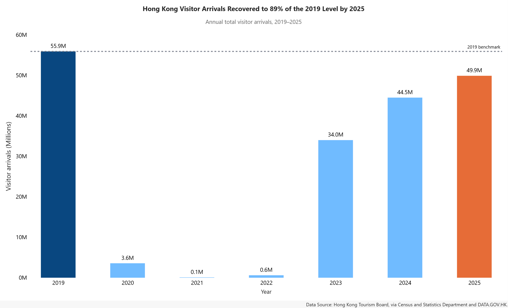
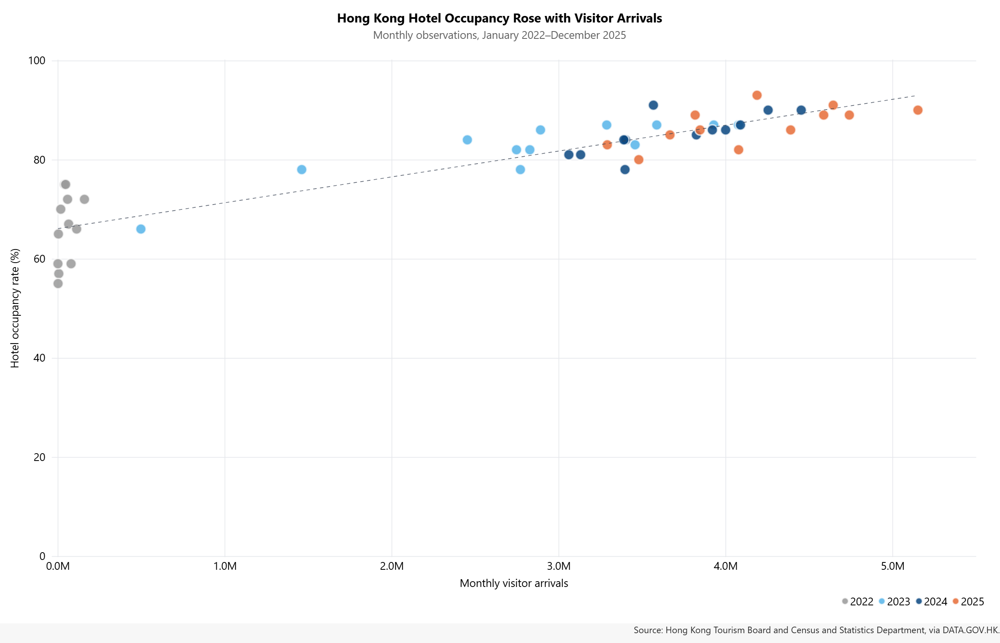
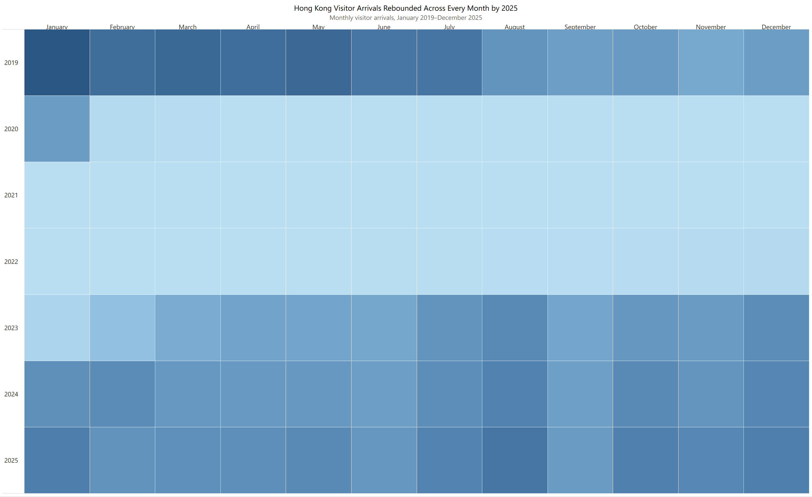

# From Collapse to Recovery: Hong Kong Tourism and Hotel Performance, 2019–2025

A data cleaning and visualization project on how Hong Kong tourism fell during COVID-19 and recovered afterwards, and how hotel occupancy and room rates moved with it. Built with **Python**, **Microsoft Power BI** and **Tableau**, using official open data from [DATA.GOV.HK](https://data.gov.hk/).

**Live Tableau chart:** [Monthly visitor arrivals heatmap on Tableau Public](https://public.tableau.com/app/profile/chusong.xu/viz/Chart3_ChusongXu/Sheet1)

## Questions

1. Did visitor arrivals return to the 2019 level by 2025?
2. How were monthly visitor arrivals associated with hotel occupancy, and how did average room rates change during the recovery?

## Key findings

| Year | Visitor arrivals | vs. 2019 | Avg. hotel occupancy | Avg. room rate (HKD) |
|---|---:|---:|---:|---:|
| 2019 | 55.9 M | 100.0% | – | – |
| 2020 | 3.6 M | 6.4% | – | – |
| 2021 | 0.09 M | 0.2% | – | – |
| 2022 | 0.6 M | 1.1% | 66.0% | 1,062 |
| 2023 | 34.0 M | 60.8% | 82.3% | 1,395 |
| 2024 | 44.5 M | 79.6% | 85.3% | 1,332 |
| 2025 | 49.9 M | 89.2% | 86.9% | 1,263 |

- **The recovery was strong but not complete.** Arrivals reached 49.9 million in 2025, 89.2% of the 2019 total and about 6 million below it. Growth slowed from 30.9% in 2024 to 12.1% in 2025.
- **Hotel occupancy rose with visitor arrivals.** Across 48 months (2022–2025) the two measures show a strong positive association (Pearson r ≈ 0.91). Months with more than 3 million visitors mostly had occupancy around 80% or higher.
- **Room rates took a different path.** The average achieved room rate peaked at HK$1,395 in 2023 and fell 9.5% to HK$1,263 in 2025, even as occupancy kept rising.
- **August 2025 was the busiest month of the recovery**, with 5.15 million arrivals.

## Visualizations

**1. Annual visitor arrivals vs. the 2019 benchmark** (Power BI)



**2. Monthly visitor arrivals vs. hotel occupancy, 2022–2025** (Power BI)



**3. Monthly visitor arrivals by year, 2019–2025** (Tableau)



Design notes for each chart are in [docs/visualization_design.md](docs/visualization_design.md).

## Data

| Dataset | Publisher | Source |
|---|---|---|
| Visitor arrivals by nationality/region | Census and Statistics Department | [DATA.GOV.HK](https://data.gov.hk/en-data/dataset/hk-censtatd-tablechart-650-80001) |
| Hotel room occupancy rate | Culture, Sports and Tourism Bureau | [DATA.GOV.HK](https://data.gov.hk/en-data/dataset/hk-cstb-cstb_tc-tc-hotel-room-occupancy-rate) |
| Average achieved hotel room rate | Culture, Sports and Tourism Bureau | [DATA.GOV.HK](https://data.gov.hk/en-data/dataset/hk-cstb-cstb_tc-tc-average-achieved-hotel-room-rate) |

The original downloads are kept unchanged in `data/raw/`, with SHA-256 checksums in [`data/source_manifest.json`](data/source_manifest.json).

## Data pipeline

[`scripts/clean_tourism_data.py`](scripts/clean_tourism_data.py) uses only the Python standard library. It:

1. Reads the visitor-arrivals API response and keeps official monthly and annual **Total** arrivals.
2. Reads the two hotel CSV files and standardizes the month key to `YYYYMM`.
3. Joins the three sources one-to-one by month for January 2022 – December 2025, the complete common period.
4. Adds typed date fields for Power BI and Tableau, and builds an annual summary with recovery vs. 2019.
5. Runs quality checks and writes a manifest with checksums.

```bash
python scripts/clean_tourism_data.py
```

Outputs in `data/cleaned/`:

| File | Rows | Use |
|---|---:|---|
| `tourism_annual_summary_2019_2025.csv` | 7 | Chart 1 |
| `tourism_hotel_monthly_2022_2025.csv` | 48 | Chart 2 |
| `visitor_arrivals_monthly_2019_2025.csv` | 84 | Chart 3 |

**Quality checks (all passed):** 48 expected months, unique join key, no missing or negative values, occupancy within 0–100%, no official values modified. See the [data cleaning log](docs/data_cleaning_log.md) and [data dictionary](docs/data_dictionary.md).

## Limitations

- The visitor-market classification changed from country/region of residence to nationality/region on 16 October 2024, so the analysis uses total arrivals rather than regional shares.
- The arrivals–occupancy relationship is descriptive and partly reflects the shared recovery over time; it does not show causation.
- Annual occupancy and room-rate figures are means of the 12 published monthly values.

## Repository structure

```text
data/
  raw/                 official downloads, unchanged
  cleaned/             analysis-ready CSV files
  source_manifest.json source URLs, checksums and quality checks
scripts/
  clean_tourism_data.py
dashboards/
  tableau/             Tableau workbook for the heatmap
figures/               exported charts
docs/                  data dictionary, cleaning log, chart design notes
```

To open the Tableau workbook, point its data source to `data/cleaned/visitor_arrivals_monthly_2019_2025.csv` if Tableau asks for the file location.

## Data licence

Source data © the Government of the Hong Kong SAR, used under the [DATA.GOV.HK Terms and Conditions](https://data.gov.hk/en/terms-and-conditions).
